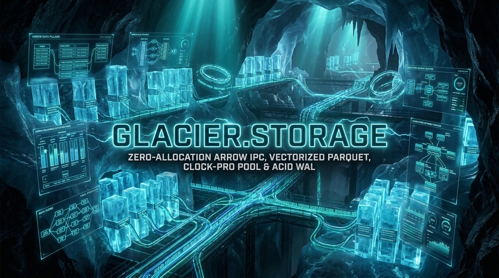
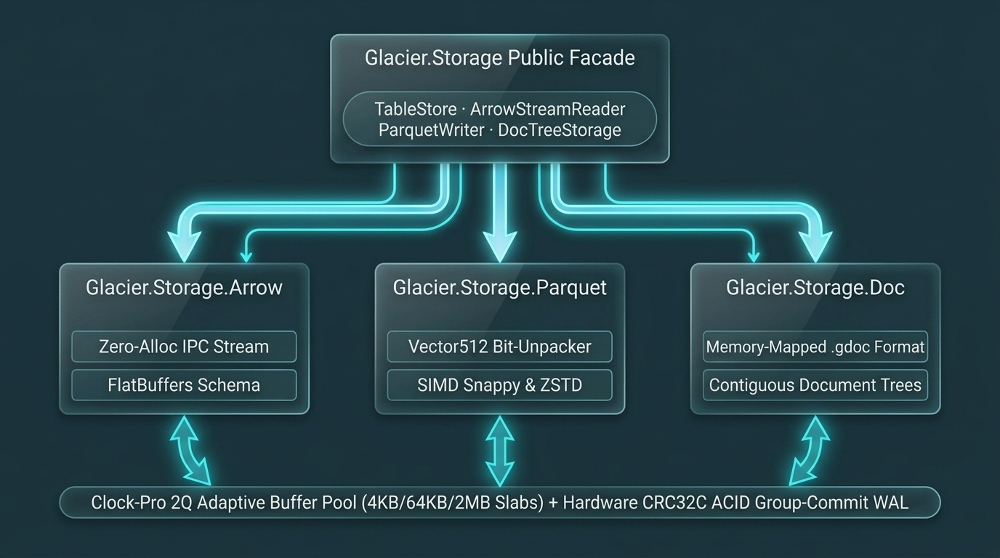

# 🗄️ Glacier.Storage

[](LICENSE)
[](https://dotnet.microsoft.com/)
[](https://learn.microsoft.com/dotnet/core/deploying/native-aot/)
[](https://github.com/ian-cowley)
[](https://glaciersoftware.dev/)
[](https://buymeacoffee.com/glaciersoftware)

> **Pillar 12 of the Glacier .NET 10 Ecosystem**: Pure managed C# zero-allocation ACID storage engine kernel featuring a multi-tiered Clock-Pro/2Q unmanaged buffer pool, double-buffered group-commit write-ahead logging (WAL), `SlottedPage` tuple storage, ALP floating-point compression, FastLanes SIMD bit-unpacking, and transactional `TableStore` backed by `Glacier.Formats` (Glacier Compact Columnar IPC v1 & Parquet v1).
> **Zero native C dependencies (`e_sqlite3.dll` eliminated); depends on pure-managed `Glacier.Formats`.**

```text
========================================================================================================
  GLACIER.STORAGE ARCHITECTURE & CAPABILITIES (.NET 10)
========================================================================================================
  Buffer Pool       : 64-byte aligned unmanaged slabs (4KB Small, 64KB Medium, 2MB Huge), Clock-Pro & 2Q
  Frame Concurrency : Atomic FrameLatch (30-bit reader count, writer lock, dirty bit) + Per-Frame State
  Slotted Page      : Variable-length tuple directory up to 65,535 bytes (PageTier.Small 4KB)
  ACID WAL          : Double-buffered lock-split group-commit engine + RandomAccess I/O + CRC-32C
  ALP Encoding      : Lossless IEEE-754 float/double compression (ALP / ALP_RD) + FastLanes unpacking
  TableStore        : IBufferPool-paged transactional batches with Glacier Compact IPC v1 & Parquet v1
========================================================================================================
```

---

## 🏛️ System Architecture

<p align="center">
  
</p>

```
                                Glacier.Storage Pipeline
 ┌────────────────────────────────────────────────────────────────────────────────────────┐
 │                             Glacier.Storage Public Facade                              │
 │                    TableStore (IBufferPool + IWalTransactionEngine)                    │
 │             Integrates Glacier.Formats (Compact Columnar IPC v1 & Parquet v1)          │
 └──────────────┬────────────────────────────┬────────────────────────────┬───────────────┘
                │                            │                            │
 ┌──────────────▼─────────────┐ ┌────────────▼─────────────┐ ┌───────────▼──────────────┐
 │  Glacier.Storage.Encoding  │ │Glacier.Storage.BufferPool│ │   Glacier.Storage.Wal    │
 │ • ALP & ALP_RD Float/Double│ │ • Clock-Pro / 2Q Cache   │ │ • Group-Commit Engine    │
 │ • FastLanesBitUnpacker     │ │ • Atomic FrameLatch/Pin  │ │ • Double-Buffered Flush  │
 │   (via Glacier.Formats)    │ │ • 4KB/64KB/2MB Slabs     │ │ • Hardware CRC-32C       │
 │ • Zone-Map Min/Max Headers │ │ • SlottedPage (<= 64KB-) │ │ • Pooled Crash Recovery  │
 └────────────────────────────┘ └──────────────────────────┘ └──────────────────────────┘
```

---

## 🚀 Key Subsystems

### 1. Transactional `TableStore` (`Glacier.Storage`)
- **Buffer-Pool-Backed Batch Storage**: Commits chunked record batch payloads directly into `IBufferPool` pages (`PagePin` exclusive writes and shared streaming reads), with explicit `leaveBufferPoolOpen` / `leaveWalOpen` ownership tracking.
- **WAL Replay & Recovery**: Replays committed `Glacier.Formats.Arrow` (**Glacier Compact Columnar IPC v1**) payloads on startup while isolating aborted or uncommitted transactions.
- **Columnar Export**: Streams committed batches directly from `IBufferPool` pages via `ExportToArrowIpc` (Glacier Compact Columnar IPC v1) or exports multi-RowGroup Parquet v1 files via `ExportToParquet` (`Glacier.Formats.Parquet`).

### 2. Multi-Tier Buffer Pool (`Glacier.Storage.BufferPool`)
- **Multi-Tier Page Slabs**: 4 KB (`PageTier.Small`), 64 KB (`PageTier.Medium`), and 2 MB (`PageTier.Huge`) slabs allocated with 64-byte native alignment and `RandomAccess` disk I/O (or `ArrayPool<byte>` in-memory backing).
- **Clock-Pro & 2Q Adaptive Replacement**: Separates Cold, Hot, and non-resident Test history pages while guaranteeing eviction safety with atomic `FrameState` (`Empty`/`Loading`/`Resident`/`Evicting`) and inflight load/eviction deduplication.
- **Non-Blocking Frame Latches & `PagePin`**: Atomic 32-bit `FrameLatch` (30-bit shared reader count with saturation guard, 1-bit exclusive lock, 1-bit dirty flag) paired with mode-aware `PagePin` disposal.
- **Slotted Page Directory**: Variable-length tuple storage (`SlottedPage`) for pages up to `65,535` bytes (`PageTier.Small`), with corrupt-header bounds validation.

### 3. ACID Write-Ahead Log (`Glacier.Storage.Wal`)
- **Lock-Split Group Commit**: `WalTransactionEngine` swaps `_activeBuffer` and `_flushBuffer` in O(1) under `_appendLock` and performs disk writes + `RandomAccess.FlushToDisk` outside `_appendLock` under `_flushLock`.
- **Hardware-Accelerated CRC-32C**: Delegates to `Glacier.Formats.Hashing.Crc32c` (SSE4.2 / ARM64 intrinsics with table fallback) when built locally, with standalone fallback for NuGet builds.
- **Crash Recovery (`WalRecovery`)**: Uses `ArrayPool<byte>` + `RandomAccess.Read` / `ReadAtLeast` to scan arbitrary-length logs without full-file heap allocations and cleanly stops at torn tails.

### 4. Lossless Floating-Point Encoding (`Glacier.Storage.Encoding`)
- **ALP & ALP_RD Compression (`AlpCompressor`)**: Bit-exact lossless IEEE-754 `float` and `double` block compression with embedded 64-bit zone-map min/max metadata and strict header/index/truncation validation.
- **FastLanes Bit-Unpacking**: `FastLanesBitUnpacker` delegates to canonical `Glacier.Formats.Encoding.FastLanesBitUnpacker` (AVX-512 / AVX2 / scalar) when built locally.

---

## 💻 Quickstart Examples

### Transactional `TableStore` with `Glacier.Formats` IPC & Parquet Export
```csharp
using Glacier.Formats.Arrow;
using Glacier.Formats.Parquet;
using Glacier.Storage;

var schema = new ArrowSchema(new[]
{
    new ArrowField("id", ArrowType.Int32),
    new ArrowField("metric", ArrowType.Double)
});

using var store = new TableStore("./my_table", schema);
TxId tx = store.BeginTransaction();

var col0 = new ArrowColumn(schema.GetField(0), rowCount, 0, default, default, idBytes);
var col1 = new ArrowColumn(schema.GetField(1), rowCount, 0, default, default, metricBytes);
var batch = new ArrowRecordBatch(schema, rowCount, new[] { col0, col1 });

store.AppendBatch(tx, batch);
await store.CommitTransactionAsync(tx);

store.ExportToParquet("data.parquet", CompressionCodec.Snappy);
```

### Buffer Pool with `PageTier.Small` & `SlottedPage`
```csharp
using Glacier.Storage;
using Glacier.Storage.BufferPool;

// Initialize 4KB small-page buffer pool with Clock-Pro (SlottedPage supports <= 65,535 bytes)
using var pool = new BufferPool(poolSize: 128, PageTier.Small);

// Allocate new page
PageId pageId = pool.AllocatePage();

// Pin page with exclusive write lock
using (PagePin pin = pool.PinPage(pageId, LockMode.Exclusive))
{
    // Write directly into 4KB unmanaged memory span
    SlottedPage.Initialize(pin.Data, pageId);
    SlottedPage.TryInsertRecord(pin.Data, "RecordPayload"u8, out ushort slot);
    pin.MarkDirty();
} // Automatically releases Exclusive latch and unpins on dispose
```

### Transactional ACID WAL with Group Commit
```csharp
using Glacier.Storage;
using Glacier.Storage.Wal;

using var logStream = new FileStream("transactions.wal", FileMode.OpenOrCreate, FileAccess.ReadWrite, FileShare.ReadWrite);
using var wal = new WalTransactionEngine(logStream, bufferCapacity: 65536, groupCommitIntervalMs: 2);

// Begin transaction
TxId txId = wal.BeginTransaction();

// Append update records (hardware CRC-32C verified)
wal.LogRecord(txId, "UPDATE inventory SET stock = 42"u8);

// Await group commit durability
await wal.CommitAsync(txId);
```

### Lossless ALP Float Compression
```csharp
using Glacier.Storage.Encoding;

float[] samples = [10.25f, 10.50f, 10.75f, 11.00f];
byte[] compressed = new byte[AlpCompressor.GetMaxCompressedLength(samples.Length, sizeof(float))];
int bytesWritten = AlpCompressor.CompressFloat(samples, compressed);

float[] restored = new float[samples.Length];
int count = AlpCompressor.DecompressFloat(compressed.AsSpan(0, bytesWritten), restored);
```

---

## 🔒 Security & Quality Standards
- **Zero Native Dependencies**: 100% managed C# .NET 10 code, Native AOT trim-safe, backed by pure-managed `Glacier.Formats` (no `e_sqlite3.dll` or native C libraries).
- **Zero Secrets Policy**: Fully compliant with `AGENTS.md`. Automated verification via `glacier security-check Glacier.Storage`.
- **Comprehensive Test Suite**: Unit, concurrency, adversarial bounds, and scalar-fallback tests covering `BufferPool` miss/eviction races, `FrameLatch` saturation, `SlottedPage` bounds, `WalTransactionEngine` lock-split group commit & disposal, `WalRecovery`, `TableStore` ownership & `IBufferPool` paging, `AlpCompressor` header/index bounds, and `FastLanesBitUnpacker` SIMD/scalar parity.

---

## Credits

Developed by **Ian Cowley** and **Antigravity (Google DeepMind)**.

---

## 📄 License
This project is licensed under the [MIT License](LICENSE). Copyright (c) 2026 Ian Cowley.

---

## ❄️ Glacier Ecosystem & Support

Part of the **[Glacier Ecosystem](https://glaciersoftware.dev/)** — high-performance, zero-allocation developer tooling and data engines natively built for modern C# and .NET 10.

* 🌐 **Website & Documentation**: [glaciersoftware.dev](https://glaciersoftware.dev/)
* ☕ **Buy Me a Coffee**: [buymeacoffee.com/glaciersoftware](https://buymeacoffee.com/glaciersoftware)
* ❤️ **GitHub Sponsors**: [github.com/sponsors/ian-cowley](https://github.com/sponsors/ian-cowley)
* 🐙 **All Repositories**: [github.com/ian-cowley](https://github.com/ian-cowley)
