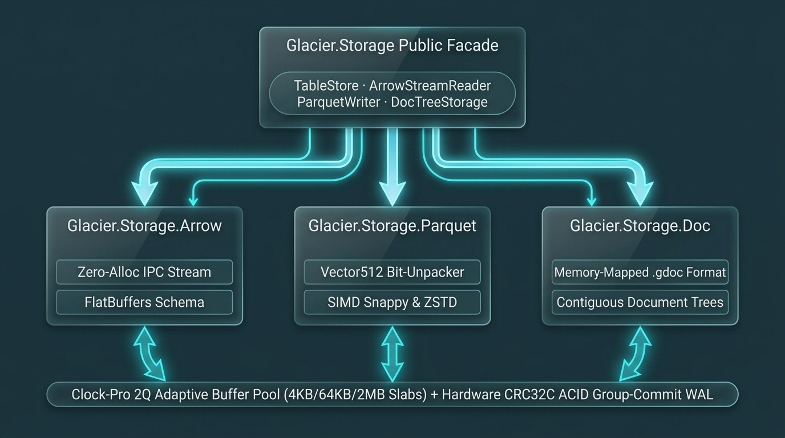
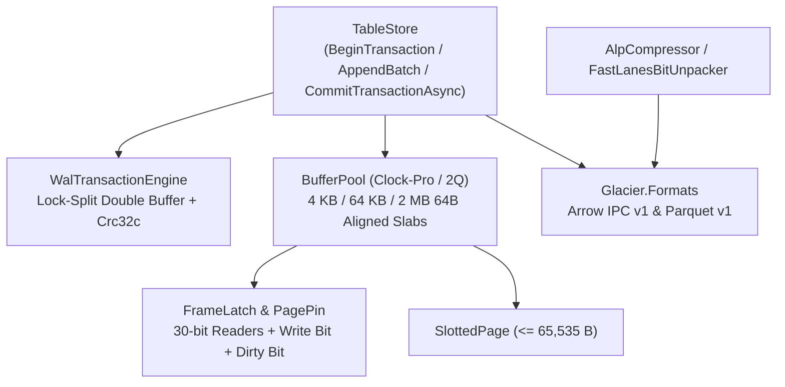

# Glacier.Storage Architecture

`Glacier.Storage` layers a transactional batch facade (`TableStore`) over three unmanaged engines: a 64-byte aligned buffer pool (`BufferPool`), a lock-split group-commit write-ahead log (`WalTransactionEngine`), and block floating-point/bit-packing codecs (`AlpCompressor` & `FastLanesBitUnpacker`).

## 1. Subsystem Pipeline

## 2. Multi-Tier Buffer Pool & Concurrency

- **Aligned Unmanaged Arenas (`BufferPool`):** Allocates a single contiguous block via `NativeMemory.AlignedAlloc(..., 64)` partitioned into `PageTier.Small` (`4 KB`), `PageTier.Medium` (`64 KB`), or `PageTier.Huge` (`2 MB`) frames backed by an optional `FileStream` (`RandomAccess` I/O) or in-memory store.
- **Atomic Frame State & Latching (`BufferFrame`, `FrameLatch`):** Separates page lifecycle states (`Empty`, `Loading`, `Resident`, `Evicting`) and inflight miss/eviction waiter signals (`ManualResetEventSlim`) from a 32-bit `FrameLatch` tracking up to 30 bits of concurrent shared readers, an exclusive writer lock bit, and a dirty bit.
- **Adaptive Replacement (`ClockProPolicy`, `TwoQueuePolicy`):** Separates Cold, Hot, and non-resident Test history pages so one-off table scans do not evict hot index or working pages.

## 3. Lock-Split Group-Commit WAL & Recovery

`WalTransactionEngine` maintains `_activeBuffer` and `_flushBuffer` behind a strict two-lock order (`_flushLock` -> `_appendLock`). Appenders serialize `WalRecord` entries with hardware-accelerated `Crc32c` under `_appendLock` (including local/fallback parity), while background timer ticks or explicit commits swap buffers under `_appendLock` and execute disk writes and `RandomAccess.FlushToDisk` under `_flushLock` without blocking concurrent transaction appends. `WalRecovery` scans log streams incrementally through `ArrayPool<byte>` buffers and stops cleanly at partial or corrupted tails.

## 4. ALP Encoding & Zone Maps

`AlpCompressor` samples up to `128` elements per `<= 65,535`-value block to choose optimal decimal scaling exponents, standard bit-packed ALP (`AlpFloat` / `AlpDouble`), `ALP_RD` split left/right dictionaries (`AlpRdDouble`), or `Constant` frames, storing a fixed 48-byte `ALP1` header with IEEE-754 zone-map `min`/`max` bits for predicate pushdown. `FastLanesBitUnpacker` delegates to `Glacier.Formats.Encoding.FastLanesBitUnpacker` in local solution builds.
